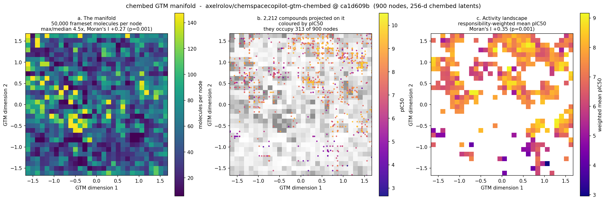

# Map-guided generation in chembed latent space

Does a GTM map of chembed latent space usefully steer molecular generation?
**No.** Perturbing the latents of the most active compounds does as well or
better at every noise level tested, and far better at the levels that produce
usable analogues.

This matters because the manuscript describes chemical space maps that
"highlight promising regions, which are subsequently targeted by generative
models". For small molecules that coupling was never implemented: the map was
built on Morgan fingerprints while generation sampled the autoencoder latent,
two unrelated spaces. chembed makes the coupling testable, because unlike the
deepchemography LSTM it encodes the large, potent chemotypes. The result is
that the coupling, once implemented, does not earn its place.

## Design

2,212 curated sEH compounds (`clean_compounds.csv`, sha256 `bc4b51ee…`) encoded
with chembed, zero SELFIES token substitutions. A GTM is fitted on those
latents, each node scored by responsibility-weighted pIC50, and the ten most
active nodes decoded back into molecules.

The baseline is the control that makes the experiment meaningful: perturb the
latents of the ten most active *compounds* by the same amount. It needs no map,
so the map has to beat it to be worth running.

Reproduce with:

```bash
python scripts/run_chembed_latent_gtm_study.py \
    --compounds reports/reviewer_revision/seh/clean_compounds.csv \
    --output-dir docs/manuscript/results/chembed-latent-gtm \
    --noise-sweep 0.1 0.25 0.5 1.0
```

## Result

200 candidates per arm per scale. Tanimoto is the median over candidates of the
maximum similarity to any of the 2,212 actives.

| noise | arm | distinct | novel | Tanimoto | SA |
|---|---|---:|---:|---:|---:|
| 0.1 | GTM-guided | 182 | 182 | 0.266 | 4.43 |
| 0.1 | active ball | 55 | 49 | **1.000** | **2.99** |
| 0.25 | GTM-guided | 199 | 199 | 0.251 | 4.55 |
| 0.25 | active ball | 148 | 143 | **0.355** | 4.57 |
| 0.5 | GTM-guided | 200 | 200 | 0.228 | 4.60 |
| 0.5 | active ball | 200 | 199 | 0.225 | **5.15** |
| 1.0 | GTM-guided | 200 | 200 | 0.202 | 5.02 |
| 1.0 | active ball | 200 | 200 | 0.192 | 5.43 |

Three things to read from it.

**The baseline wins where it matters.** At 0.1 it reproduces the actives
themselves (Tanimoto 1.000) at SA 2.99, and at 0.25 it yields 148 distinct
molecules at Tanimoto 0.355. Those are analogues. The GTM arm never exceeds
Tanimoto 0.27.

**The GTM arm barely responds to noise.** Its similarity moves only from 0.266
to 0.202 across a tenfold change in scale, and its SA stays near 4.5. That is
the signature of decoding regional averages: a node centre already sits away
from any real molecule, so perturbing it changes little.

**Convergence at high noise is not parity.** At 0.5 and 1.0 the two arms agree,
because by then the baseline has also been pushed off the data manifold. Both
are then producing dissimilar, hard-to-make molecules. Agreement there says the
map is no worse than a broken baseline, not that it works.

## The map is informative; the decoding is not



It would be easy to read the result above as "the map carries no signal". It
does carry signal, and that is what makes the failure specific rather than
general.

The manifold is not flat. Across its 900 nodes the 50,000 frameset molecules
vary 4.5-fold between the median node and the densest, with a coefficient of
variation of 0.63, and the density is spatially autocorrelated (rook-contiguity
Moran's I +0.266, permutation p = 0.001).

More to the point, **activity is spatially organized**. The 2,212 sEH compounds
occupy 313 of the 900 nodes, and the responsibility-weighted mean pIC50 over
those nodes has Moran's I +0.352 (p = 0.001): neighbouring nodes hold compounds
of similar potency, with a high-activity region in the upper right and a
low-activity one toward the lower left. A map that highlights promising regions
is doing its job.

So the coupling does not fail because the map cannot find active regions. It
fails at the step after that, turning a region back into molecules. A node
centre is an average over a region of a 256-dimensional space compressed to
two, and reconstructing a molecule through the map leaves a relative error near
0.6. The centre is a real description of where the actives are and a poor
starting point for generating one.

That suggests the useful way to spend this map is to select regions or
compounds with it and then perturb **real molecules** found there, rather than
decoding the geometry itself. That is close to what the baseline already does,
which is consistent with the baseline winning.

## Why

A GTM manifold is two-dimensional and the chembed latent is 256-dimensional.
Reconstructing a molecule through the default map leaves a relative error
around 0.6, so a node centre is a summary of a region, not a point near any
compound in it. Decoding one lands off the data manifold, which is exactly what
the high novelty and high SA together describe: molecules nothing has seen,
because they are not quite molecules anyone would make.

## Caveats

- SELFIES decode to a valid molecule by construction. Validity is 1.0 for both
  arms by definition and is not reported as evidence.
- Generated activity is unproven. Node enrichment guides sampling only; nothing
  here measures whether a generated molecule binds sEH.
- Novelty is relative to the 2,212-compound training set, not to the pinned
  MOSES reference used elsewhere in the manuscript. chembed's training corpus
  is a different publication, so the MOSES framing does not transfer.
- One target, one activity type, one manifold. This shows the coupling failed
  here; it does not prove no map can steer generation.
